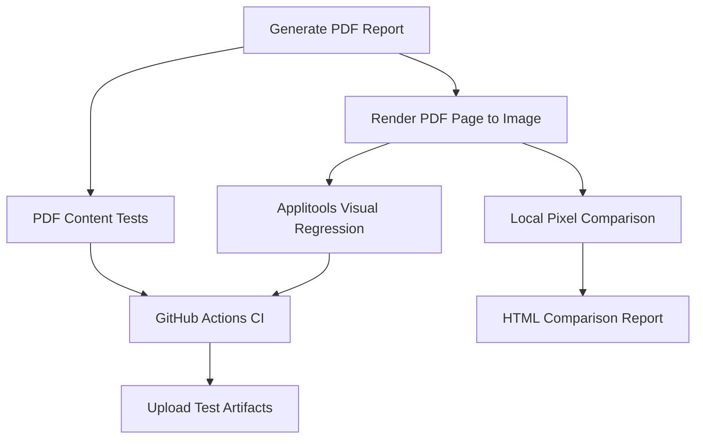

# PDF Visual Testing Framework

[](https://github.com/liat159/pdf-visual-testing/actions/workflows/ci.yml)


A Python-based test automation project for validating PDF reports through **content verification, visual regression testing, and image comparison**.

The framework demonstrates how to generate a PDF report, validate its business content, compare its rendered appearance against an established visual baseline, and execute automated checks in a GitHub Actions CI pipeline.

**Repository:** [liat159/pdf-visual-testing](https://github.com/liat159/pdf-visual-testing)

---

## Table of Contents

- [Project Overview](#project-overview)
- [Key Features](#key-features)
- [Architecture and Workflow](#architecture-and-workflow)
- [Project Structure](#project-structure)
- [Technology Stack](#technology-stack)
- [Getting Started](#getting-started)
- [Running the Tests](#running-the-tests)
- [Visual Regression Testing with Applitools](#visual-regression-testing-with-applitools)
- [Local Visual Comparison Report](#local-visual-comparison-report)
- [Continuous Integration](#continuous-integration)
- [Test Coverage](#test-coverage)
- [Security and Configuration](#security-and-configuration)
- [Future Improvements](#future-improvements)

---

## Project Overview

PDF reports are often business-critical artifacts. A report may contain correct data while still presenting visual defects such as misaligned tables, unexpected font changes, incorrect colors, or layout shifts.

This project addresses both dimensions of PDF quality:

- **Content correctness:** Verify that expected report information is present and that key business values are correct.
- **Visual correctness:** Detect unexpected changes in the rendered appearance of a PDF.
- **Automation and repeatability:** Generate the report and execute automated checks consistently.
- **CI integration:** Run automated tests in a clean GitHub Actions environment and retain test artifacts for troubleshooting.

The sample application generates a monthly orders report containing order identifiers, products, quantities, unit prices, line totals, and a grand total.

## Key Features

### 1. Automated PDF Generation

Generates a sample monthly orders report programmatically using ReportLab.

The report includes:

- Report title and reporting period
- Order details in a structured table
- Calculated line totals
- Grand total
- Total order count

### 2. PDF Content Validation

Uses PyMuPDF to extract text from the generated PDF and pytest to validate its contents.

The tests verify that:

- The expected report title and reporting period exist.
- All expected order IDs are present.
- The grand total matches the expected value.
- The report contains the expected number of orders.

### 3. Visual Regression Testing

Uses the Applitools Images SDK to compare a rendered report image against a visual baseline.

This helps detect unintended visual changes that content-only assertions may not identify.

The test fails when Applitools reports visual differences, allowing unexpected changes to be investigated before they are accepted.

### 4. Local Pixel-Difference Analysis

Provides an additional local image-comparison utility that generates:

- A pixel-difference image highlighting visual changes.
- An HTML report displaying the baseline, current image, and difference image.

This complements Applitools by providing a straightforward visual aid for local debugging. The pixel-difference output is a separate comparison mechanism, not an Applitools Visual AI result.

### 5. Continuous Integration with GitHub Actions

Automates the testing workflow on pushes, pull requests, and manual workflow dispatches.

The pipeline installs dependencies, generates the PDF, runs content tests, executes the Applitools visual regression test, and uploads available reports and screenshots as workflow artifacts.

---

## Architecture and Workflow

The project separates PDF generation, rendering, validation, visual comparison, and CI orchestration.



### Execution flow

1. Generate the PDF report from predefined sample order data.
2. Extract PDF text and validate expected business content.
3. Render the PDF page into an image.
4. Submit the rendered image to Applitools for visual comparison.
5. Optionally generate a local pixel-difference image and HTML comparison report.
6. Execute the automated checks in GitHub Actions.
7. Review the test results and download available CI artifacts when troubleshooting is needed.

---

## Project Structure

```text
pdf-visual-testing/
│
├── .github/
│   └── workflows/
│       └── ci.yml
│
├── reports/
│   └── baseline.png
│
├── sample_reports/
│   ├── generate_report.py
│   └── render_report.py
│
├── tests/
│   ├── test_report_content.py
│   ├── test_report_visual.py
│   └── test_visual_smoke.py
│
├── tools/
│   └── create_visual_comparison.py
│
├── .gitignore
├── requirements.txt
└── run_visual_check.py
```

### Component responsibilities

| Component | Responsibility |
|---|---|
| `sample_reports/generate_report.py` | Generates the sample PDF report using ReportLab. |
| `sample_reports/render_report.py` | Renders a PDF page into an image for visual inspection and comparison. |
| `tests/test_report_content.py` | Validates extracted PDF text and expected business values. |
| `tests/test_report_visual.py` | Executes the Applitools visual regression test. |
| `tests/test_visual_smoke.py` | Contains an additional visual smoke test. |
| `tools/create_visual_comparison.py` | Generates a local pixel-difference image and HTML comparison report. |
| `run_visual_check.py` | Orchestrates the local visual test and comparison-report generation. |
| `.github/workflows/ci.yml` | Defines the automated GitHub Actions pipeline. |
| `reports/baseline.png` | Local reference image used by the pixel-comparison utility. |

**Note:** The Applitools baseline is managed through the Applitools testing configuration and dashboard. The local `reports/baseline.png` serves the separate pixel-comparison utility.

---

## Technology Stack

| Technology | Purpose |
|---|---|
| Python 3.11 | Automation framework and test implementation |
| pytest | Test execution, fixtures, parametrization, and assertions |
| PyMuPDF | PDF text extraction and page processing |
| ReportLab | Programmatic PDF report generation |
| Pillow | Image processing and pixel-level comparison |
| Applitools Images SDK | Visual regression testing |
| GitHub Actions | Continuous integration and artifact storage |
| HTML | Human-readable local visual comparison report |

---

## Getting Started

### Prerequisites

Install or prepare the following:

- Python 3.11
- Git
- A GitHub account
- An Applitools account and API key for the visual regression test

### 1. Clone the repository

```bash
git clone https://github.com/liat159/pdf-visual-testing.git
cd pdf-visual-testing
```

### 2. Create a virtual environment

**Windows PowerShell:**

```powershell
python -m venv .venv
.\.venv\Scripts\Activate.ps1
```

If PowerShell blocks activation, use an appropriate local execution policy or activate the environment using your preferred Python tooling.

### 3. Install dependencies

```powershell
python -m pip install --upgrade pip
pip install -r requirements.txt
```

### 4. Configure the Applitools API key

The visual regression test requires the `APPLITOOLS_API_KEY` environment variable.

For a temporary PowerShell session:

```powershell
$env:APPLITOOLS_API_KEY = "YOUR_APPLITOOLS_API_KEY"
```

Replace the placeholder with your own key. Do not commit the key to source control.

For CI, configure the key as a GitHub Actions repository secret named `APPLITOOLS_API_KEY`.

### 5. Generate the sample PDF

```powershell
python sample_reports/generate_report.py
```

The generated report is saved to:

```text
sample_reports/monthly_orders_report.pdf
```

The PDF is generated locally and in CI rather than being maintained as a committed build artifact.

---

## Running the Tests

### Run PDF content tests

```powershell
python -m pytest tests/test_report_content.py -v
```

These tests validate the report's extracted text, expected order identifiers, grand total, and order count.

### Run the Applitools visual regression test

Ensure `APPLITOOLS_API_KEY` is configured, then run:

```powershell
python -m pytest tests/test_report_visual.py -v
```

The test generates a fresh PDF, renders it into an image, and submits the image for comparison against the Applitools baseline.

A visual mismatch is reported as a test failure so that the difference can be reviewed.

### Run the visual smoke test

```powershell
python -m pytest tests/test_visual_smoke.py -v
```

This is an additional test module for visual smoke testing. Its execution requirements depend on its implementation and configuration.

### Run the complete test suite

```powershell
python -m pytest -v
```

This collects the available pytest tests in the project. Tests that require external configuration, including Applitools credentials, must be configured before running the complete suite.

### Run the local visual-check workflow

```powershell
python run_visual_check.py
```

This script runs the visual regression test and then attempts to generate the local HTML comparison report.

The HTML report requires the local baseline and current rendered image to exist and have matching dimensions. The script may open the report in the local browser.

---

## Visual Regression Testing with Applitools

The visual test follows these steps:

1. Generate the current PDF report.
2. Render the PDF page into an image.
3. Open an Applitools test named `Monthly Orders Report` in the `PDF Visual Testing` application.
4. Submit the rendered image for comparison.
5. Close the test and retrieve the result.
6. Fail the pytest test if Applitools reports visual differences.

### Baseline management

A baseline represents the expected visual appearance of the report.

When a test detects a difference:

1. Open the test results in the Applitools dashboard.
2. Inspect the baseline and actual images.
3. Determine whether the difference is an intended change, a rendering variation, or a defect.
4. Update the baseline only after validating that the new appearance is correct.

**Do not automatically approve every detected difference.** Baseline updates should be deliberate and reviewed.

---

## Local Visual Comparison Report

The local comparison utility offers a complementary way to inspect visual changes.

It produces:

- `reports/visual_diff.png` — a visual representation of pixel differences.
- `reports/visual_comparison.html` — an HTML page displaying the comparison.
- `reports/monthly_orders_report.png` — the current rendered report image.

The comparison utility checks that the baseline and current image are available and have matching dimensions before generating the report.

Pixel differences can be caused by meaningful layout changes as well as rendering differences. This output is intended for investigation and should not be treated as equivalent to Applitools Visual AI analysis.

Generated output files are excluded from version control, while the local baseline image is retained in the repository.

---

## Continuous Integration

The workflow is defined in `.github/workflows/ci.yml`.

It runs on:

- Push events
- Pull requests
- Manual workflow dispatches

### Pipeline stages

| Stage | Description |
|---|---|
| Checkout | Retrieves the repository contents. |
| Python setup | Configures Python 3.11 and pip caching. |
| Dependency installation | Installs the packages listed in `requirements.txt`. |
| PDF generation | Creates a fresh sample PDF in the runner. |
| Content validation | Runs the PDF content test module. |
| Visual regression | Runs the Applitools visual test using the repository secret. |
| Artifact upload | Uploads available reports, screenshots, and the generated PDF. |

### CI results

A successful workflow indicates that the configured tests passed in the GitHub Actions environment.

When a test fails, inspect the failing workflow step and its logs. If the failure is visual, review the corresponding Applitools results before changing the baseline.

Artifacts are configured to be retained for 14 days.

**Workflow status:** [View GitHub Actions runs](https://github.com/liat159/pdf-visual-testing/actions)

---

## Test Coverage

The content test module contains six test cases:

| Test | Validation |
|---|---|
| `test_report_title_and_period_exist` | Verifies the report title and reporting period. |
| `test_all_orders_are_present[ORD-1001]` | Verifies that order `ORD-1001` is present. |
| `test_all_orders_are_present[ORD-1002]` | Verifies that order `ORD-1002` is present. |
| `test_all_orders_are_present[ORD-1003]` | Verifies that order `ORD-1003` is present. |
| `test_grand_total_is_correct` | Verifies the expected grand total of `$11,500.00`. |
| `test_order_count_is_correct` | Verifies that the report contains three orders. |

The visual regression module separately checks the rendered report against the configured Applitools baseline.

The project demonstrates complementary testing techniques: text assertions validate business content, while visual regression detects changes in presentation.

---

## Security and Configuration

- Store the Applitools API key in an environment variable or GitHub Actions secret.
- Never hardcode credentials in Python files or workflow configuration.
- Do not commit `.env` files, virtual environments, or generated test output.
- Review visual differences before approving baseline changes.
- Keep generated artifacts separate from source code and test configuration.

---

## Future Improvements

Potential enhancements include:

- Adding more PDF templates and report variations.
- Introducing parametrized tests for additional report data sets.
- Testing multi-page PDF documents and page-specific rendering.
- Adding negative tests for missing or incorrect report content.
- Improving CI artifact organization and failure diagnostics.
- Publishing a concise test summary in GitHub Actions.
- Adding more robust handling for rendering differences across operating systems.
- Extending the framework with configurable test data and environment settings.

These are possible future extensions and are not claimed as current functionality.

---

## Author

**Liat Karavani**

QA Automation Engineer | Python | pytest | API & Visual Testing

GitHub: [@liat159](https://github.com/liat159)

---

*This project demonstrates practical test automation skills across PDF generation, content validation, visual regression testing, and continuous integration.*
